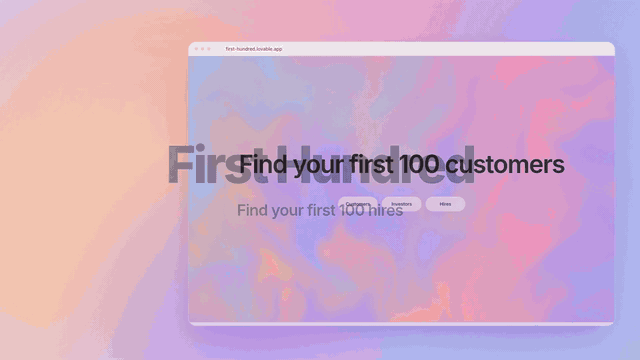

# First Hundred

**Find your first 100 customers, one film at a time.**

Co-built by [Ashwin Tiwari](https://github.com/tiwaker9404) and [Jakob Volbracht](https://github.com/Jakobuus). 🏆 Winner of Zero to Hundred: GTM Vibe Coding Hackathon, San Francisco, November 2026.



[Watch the 35-second demo with sound](docs/media/first-hundred-demo.mp4)

The hackathon was hosted by Lovable and the Swedish-American Chamber of Commerce at JPMorgan Chase.

Every early founder gets stuck on the same question: who are my first customers, and what do I even say to them? First Hundred answers it in four steps:

1. **Pitch out loud.** A 60-second voice interview captures your offer, your buyer, your proof and your ask.
2. **Pick companies.** It suggests real companies that fit your buyer, with one line on why each fits now. You can also paste your own list or import the people at a Luma event.
3. **A film for each one.** Every company gets a 30-second [coldopen](https://coldopen-nk8o.onrender.com) film made from its own website, in its own brand.
4. **An email in your words.** The first email is written from your interview answers and addressed to a named person, with the film link and your signature.

A pipeline tracks each conversation from sent to customer, and a Road to 100 view shows the count climbing.

## How it's built

| Part | Where |
|---|---|
| App | TanStack Start (React 19, Vite, Tailwind), built in [Lovable](https://lovable.dev) |
| Voice interview | Lovable Live relay: `src/lib/live-relay.server.ts`, hook `src/hooks/use-live-voice.ts` |
| Answers from the interview | `src/lib/interview.functions.ts`, normalized and tested in `src/lib/interview.ts` |
| Company suggestions, recipients, emails | `src/lib/fh/outreach.ts` (tested), served by `src/lib/outreach.functions.ts` |
| Films | coldopen API client: `src/lib/fh/coldopen-client.ts`, `src/lib/coldopen.functions.ts` |
| Sign-in, saved workspaces | Lovable Cloud (Supabase): `src/app/lib/auth.tsx`, `src/app/lib/store.tsx` |
| Daily limits per user | `src/lib/limits.server.ts` |

Server logic lives in server functions; the browser never sees an API key.

## Run it locally

```sh
bun install
bun run dev
```

## Run your own

No keys ship with the code. Connect your own services:

- Lovable Cloud for the AI gateway and Supabase auth/database, or your own Supabase project with the migration in `drizzle/migrations/`.
- coldopen for films: `COLDOPEN_URL` and `COLDOPEN_API_KEY`. Without them the app skips films and still writes emails.
- Hunter: optional `HUNTER_API_KEY`. Without it recipients are a labelled guess.

Set secrets in your hosting service. Optional `FH_PAUSED=1` pauses paid calls. `FH_UNLIMITED_USER_IDS` is a comma-separated list of users exempt from caps (the pause still applies).

Checks: `bun run test` and `bun run build`.

## Credits

Films by [coldopen](https://coldopen-nk8o.onrender.com), my personalized outreach film engine. Thanks to Lovable, the Swedish-American Chamber of Commerce, JPMorgan Chase, and our judges.
